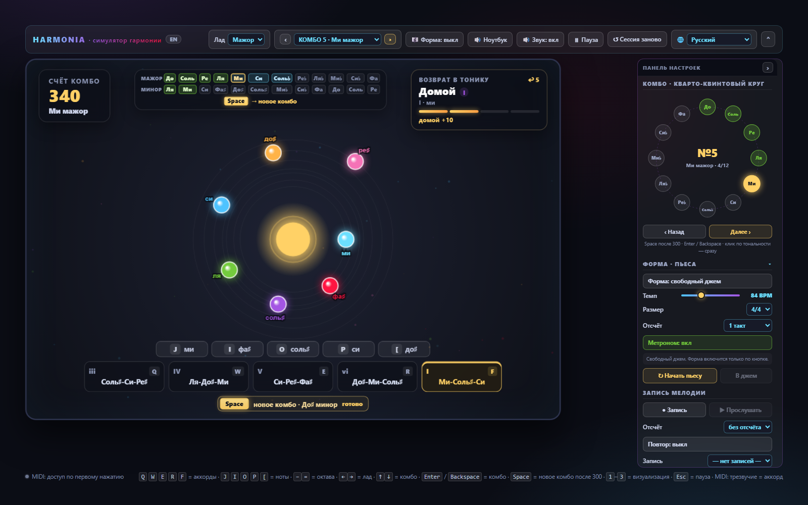

# HARMONIA

Симулятор орбит тональностей: 24 комбо из COMBOLIST (мажор/минор парами) идут по
кварто-квинтовому кругу. MIDI-клавиатура — не «пять кнопок», а слух приложения:
любая нота звучит своей высотой, зажатое трезвучие распознаётся как ступень лада
(или как краска вне его), а семь шаров показывают все семь ступеней. Плюс живая
панель параметров и след от шаров. Без сборки, без зависимостей, без интернета.



Репозиторий: <https://github.com/godspace/HARMONIA>

## Запуск

- **Двойной клик по `index.html`** — всё работает с `file://`.
- Или локальный сервер: `python -m http.server 8080` → <http://localhost:8080/>.
- GitHub Pages: Settings → Pages → Deploy from branch → корень. `index.html` — точка входа; сайт: <https://godspace.github.io/HARMONIA/>.

Перед стартом приложение проводит **пробу пальцев**: нужно положить руки на
клавиши и нажать все десять игровых клавиш — `Q W E R F` (аккорды) и
`J I O P [` (ноты). Каждая отвечает звуком, повтор не считается; после десятой
стартовое окно гаснет и начинается симулятор (`CFG.introFadeMs`). Те же клавиши
можно нажать на схеме — мышкой или пальцем, поэтому вход работает и на планшете.
Клик мимо клавиш старт не открывает.

Текста на стартовом экране всего две строки: название и одна инструкция со
счётчиком `0 / 10`. Всё остальное место занимает интерактивная клавиатура во всю
ширину — те же четыре ряда, что и в игре, с подписями рук. Прогресс несут сами
клавиши: игровая подсвечивается, после нажатия гаснет и получает ✓, а счётчик
показывает, сколько осталось. Схема живёт вне `#game-container`, поэтому
`fitStage()` её не масштабирует и клавиши остаются читаемыми на телефоне. На
время пробы весь хром скрыт: ни верхнее меню, ни панель настроек не отвлекают.

После старта сцена остаётся чистой: панели свёрнуты, у краёв — только табы
**⌄ Меню** и **⚙ Настройки**. Игрок сразу играет, а меню открывает сам, когда
понадобится: **⌃** в конце топбара сворачивает верхнюю полосу, **›** в шапке
панели — правую колонку. Сцена пересчитывает масштаб (`fitStage()`) и забирает
освободившиеся пиксели, так что закрытые панели — это не пустые поля, а место
для игры. Состояние помнится до перезагрузки: в каждой сессии сцена начинается
чистой.

Требуется браузер с Canvas 2D и Web Audio; MIDI — в Chrome/Edge (Web MIDI).

## Управление

| Действие | Клавиши |
| --- | --- |
| Старт: проба пальцев — нажать все десять клавиш на схеме или клавиатуре | `Q W E R F` + `J I O P [` |
| Аккорды левой руки (II/III · IV/iv · V · VI/vi · тоника) | `Q` `W` `E` `R` `F` |
| Ноты правой руки: 5 безопасных ступеней вокруг аккорда (умное переключение) | `J` `I` `O` `P` `[` |
| Ноты правой руки: 5 фиксированных корней (умное переключение выкл.) | `J` `I` `O` `P` `[` |
| Умное переключение аккордов и правой руки: вкл / выкл | кнопка **Звук → Умное переключение** |
| Октава мелодии (выше / ниже) | `=` / `−` или **Звук → Октава нот** |
| Следующее / предыдущее комбо (лад чередуется) | `Enter` / `Backspace` или `↑` / `↓` |
| Новое комбо после 1000 очков | `Space` или кнопка **Space** под аккордами |
| Лад: мажор / минор | `←` / `→` или переключатель **Лад** в топбаре |
| Визуализация сцены (`1` — орбиты, `2` — спектр, `3` — круг) | меню **Визуализация** в панели или `1` `2` `3` |
| Пауза, звук, очистка следа, сессия заново | `Esc`, `M`, `C`, `0` |
| Педаль (демо-клавиатура) | кнопка **Звук → Педаль**; MIDI CC64 |
| Запись и прослушивание мелодии | панель **Запись мелодии**; отсчёт 0–2 такта и **Повтор** — там же |
| Форма-пьеса (необязательный слой) | кнопка **🎼 Форма** в топбаре или панели; `Esc` ставит пьесу на паузу вместе с джемом |
| Выдвижные панели: свернуть / вернуть | **⌃** в топбаре и **›** в шапке панели; вернуть — табы **⌄ Меню** и **⚙ Настройки** |

На счёте **1000** под карточками аккордов загорается и пульсирует **Space**.
Нажатие сразу переключает на новое комбо, не открывая модального окна и не
отрывая рук от игры: мажор ведёт в минор той же пары, а минор — в мажор
следующей пары. Так лады чередуются, а счёт каждого комбо снова начинается с
нуля. До рубежа кнопка показывает прогресс `0 / 1000`. Ручные `Enter`/`↑` и
`Backspace`/`↓` тоже идут по этому чередующемуся маршруту; `←`/`→` и
переключатель **Лад** по-прежнему задают лад напрямую, сохраняя номер комбо.
Очки даёт не только возврат в тонику: каждый осмысленный переход оценивается по
функции (T/S/D), общим тонам, движению корней и разрешению вводного тона.
`ii → V → I` получает подготовку доминанты и автентический каданс, `IV → I` —
плагальный, а `V → vi` — прерванный оборот. Зачин с `ii`/`IV` тоже поощряется,
поэтому красивое начало с супертоники не проигрывает тонике. Повтор одной и той
же пары постепенно слабеет, а возврат в тонику добавляет бонус за разнообразие
фразы и наличие в ней и субдоминанты, и доминанты. Последний переход и зачин видны
в индикаторе возврата: `красиво +N`, а ожидаемый возврат показывает `домой +N`.

Шаров семь — по одному на ступень лада. Правая рука имеет два режима, которые
переключает одна кнопка **Звук → Умное переключение**:
- **вкл (по умолчанию).** Пять клавиш `J I O P [` играют безопасное окно из
  пяти ступеней вокруг текущего аккорда (anchor). Это не обязательно подряд
  идущие ноты: после V в до мажоре окно — `G A B D E`, а не `G A B C D`, потому
  что `C` образует с `B` малую секунду. Из двадцати одного набора выбирается
  тот, где больше тонов текущего аккорда и меньше полутоновых/тритоновых
  столкновений; предыдущее окно получает бонус за общие ноты, поэтому раскладка
  не «дрожит» от каждой смены. Окно ждёт отпускания клавиш и переезжает после
  смены аккорда, а не под зажатой рукой; задержка — `CFG.adaptiveSwitchMs`
  (180 мс), плюс пауза `CFG.adaptiveNoteGuardMs` после сыгранной ноты.
  Уменьшённые трезвучия не становятся новым центром: окно остаётся на
  устойчивой функции с общими тонами. Q левой руки тоже адаптивная: она
  старается попасть в цель тренажёра/пьесы, а при выборе среди оставшихся
  ступеней максимизирует общие тоны с текущим аккордом и правой рукой.
  `W E R F` остаются привычными IV · V · vi · I (в миноре iv · V · VI · i).
- **выкл.** Клавиши `J I O P [` играют фиксированные пять корней комбо
  (в мажоре I · ii · IV · V · vi, в миноре i · III · iv · V · VI), а Q · W · E ·
  R · F — прежние пять аккордов лада. Умного переключения нет; при возврате в
  smart окно и anchor заново синхронизируются с последним звучавшим аккордом.

Клавиши `−`/`=` сдвигают мелодию на октаву (или **Звук → Октава нот**), не двигая
шары: высота меняется только у звука. MIDI по-прежнему играет всё в любой октаве.
Цвет закреплён за ступенью, радиус — за высотой тона. Одиночная нота сначала
звучит одна: автотрезвучие появляется через `CFG.noteChordSettleMs` (140 мс),
если нота задержалась. Включать его отдельно не нужно — параметра «Аккорды на
нотах» больше нет. В smart-режиме подложка берёт текущий аккорд левой руки и не
добавляется вовсе, если нота образует с ним малую секунду или тритон; без smart
она строится от самой ноты. Следующая нота отменяет предыдущий план, поэтому
быстрые арпеджио не превращаются в гармоническую «кашу».

### MIDI слушает, а не переключает

Любая нажатая нота — это нота: своя высота в любой октаве, своя громкость. Через
`CFG.recognizeMs` (70 мс) после последнего изменения зажатые ноты складываются в
трезвучие, и приложение называет его: ступень лада (I…vii°), вторичная доминанта
(`V/ii`) или «краска» вне лада. Таблица «эта клавиша = этот аккорд» больше не нужна.

- **Педаль** (CC64) держит отпущенные ноты: они продолжают звучать и участвуют в
  распознавании; CC123 — паника. Педаль **включена по умолчанию**; режим
  «нажата / отпущена» переключает кнопка **Звук → Педаль** (и MIDI CC64).
  `Space` больше не управляет педалью: он открывает новое комбо после 1000.
  Нажатая педаль удлиняет хвосты аккордов и нот, отпущенная — сразу гасит их.
  Хвосты под педалью затухают быстрее (`CFG.pedalFadeMs` = 1.4 с, плато 35 %),
  а старые голоса уступают новым, поэтому долгая педаль не превращается в «кашу».
- **Звук нот** решается по устройству: контроллер без динамиков (microKEY, MPK,
  KeyStep…) озвучивает ноутбук, stage piano со своими колонками — нет. Переключатель
  в топбаре (**Ноутбук / Пианино**) помнит выбор для каждого `input.id`.
- HUD слева показывает счёт текущего комбо, справа — индикатор возврата в тонику:
  тоническую ступень, шкалу накопленного напряжения (до четырёх шагов) и число
  возвратов. Сыгранные шаги отмечаются галочками на карточках аккордов, следующий
  шаг подсвечивается там же. Распознанный аккорд по-прежнему подсвечивает шары.

### Запись мелодии

В панели **Запись мелодии** есть **● Запись**, **▶ Прослушать**, список сохранённых
записей и **Удалить**. Записываются аккорды и ноты вместе с таймингом; список хранится
в `localStorage` и переживает перезагрузку. Прослушивание идёт через тот же синтезатор,
но не меняет счёт и шаги. Запись останавливается сама через
3 минуты или 6000 событий, чтобы не переполнять хранилище.

Перед стартом можно выбрать **Отсчёт** (без отсчёта / 1 такт / 2 такта): метроном
даёт клики, а запись начинается ровно на следующей сильной доле. Ноты, сыгранные
во время отсчёта, не попадают в запись. Переключатель **Повтор** зацикливает
прослушивание выбранной записи; повтор идёт через тот же синтезатор и не начисляет
очки.

### Форма-пьеса (необязательно)

Свободный джем остаётся режимом по умолчанию: пока **Форма** выключена, нет ни
метронома, ни отсчёта, ни целей по тактам. Кнопка **🎼 Форма** в топбаре или панели
запускает 16-тактную пьесу поверх той же игры — аккорды, ноты, счёт и визуализация
работают как обычно.

- **Драматургия:** `Интро` (2 такта) → `A` (4) → `B` (4) → `A′` (4) → `Кода` (2).
  Секции и цели заданы в `CFG.composition`, а не зашиты в интерфейс.
- **Часы:** темп 84 BPM, размер 4/4 (или 3/4), отсчёт 0 / 1 / 2 такта и метроном
  настраиваются в панели. Метроном идёт через мастер-шину, поэтому `M` глушит и его.
- **Мягкие цели:** на каждый такт в текущем ладу предлагается ступень (`I`, `vi`,
  `V`…). Попадание даёт +2 и зажигает такт; промах ничего не ломает. Цели — строки
  ступеней, поэтому смена лада или комбо посреди пьесы остаётся корректной.
- **Очки формы:** попадания в цели, бонусы за сыгранную секцию, половину целей и
  три разных аккорда, а также каданс в коде (тоника +10 или доминанта +4). Очки
  идут в общий счёт текущего комбо и отдельно суммируются как «форма».
- **Пауза и финал:** `Esc` останавливает часы вместе с игрой; продолжение — с того
  же места. После 16 тактов открывается модальный экран результата с разбивкой по
  секциям и кнопками **Ещё раз** / **В джем**. Пока он открыт, игровые клавиши и
  пауза заблокированы, чтобы нельзя было случайно «продолжить» законченную пьесу.
- **Мелодия в результате:** сыгранные во время пьесы ноты считаются по секциям.
  Экран результата показывает количество нот, диапазон и число разных звуков —
  это обратная связь, а не дополнительные очки.
- **Запись:** если писать мелодию во время пьесы, в запись попадают `form`
  (BPM, размер, число тактов) и номер такта/секции каждого события.

## Визуализации

Три режима сцены (`1`–`3`, меню **Визуализация**). По умолчанию открываются
**орбиты**; физика у всех общая — угол, скорость, след и счётчик колец живут в
`render.js`, режим задаёт только геометрию, то есть что именно значат угол и радиус.
Поэтому один и тот же звук в любом режиме остаётся честным: шар не может «уехать»
с той точки, которую описывает формула.
Скорость покоя по умолчанию `0`: шары стоят и двигаются только от нажатий (импульс
`150°`, затухание `1.00 с`), а полный оборот больше не начисляет очки — счёт растёт
от игры. Затухание следа по умолчанию `35 %/с`, реверберация — `100 %`.

| Режим | Угол | Радиус / высота | О чём говорит |
| --- | --- | --- | --- |
| **Орбиты** | интеграл угловой скорости | логарифм частоты | музыкален только радиус: наглядная «высота» ноты |
| **Спектр** | логарифм частоты: 72 луча = 72 бина | длина луча — уровень бина | измерение выхода: солнце дышит по RMS, внизу центр масс μ |
| **Круг** | квинтовый шаг от тоники (тоника сверху) | высота тона, логарифмически | функции: V справа, IV слева, семь ступеней — на своих станциях |

На **круге** поверх кольца высот лежит *пояс аккорда*: треугольник из тонов звучащего
аккорда, общие тоны с предыдущим аккордом — белые точки (голосоведение), переход
корней — дуга со стрелкой по поясу. Цвет — функция аккорда: T золотая, S голубая,
D красная. Аккорд гаснет за `CFG.chordFadeMs`, треугольник не мешает играть дальше.

Подписи на **круге** стоят на двенадцати станциях: имя голоса — его цветом,
тоника — золотом, прочие станции приглушённо. Сами шары в «круге» не рисуются —
остаются станции, имена и треугольник аккорда, поэтому картинка не шумит. Шаров
по-прежнему семь — по одному на ступень лада; сыгранный аккорд подсвечивает свои
станции, а октава читается радиусом (r = rMax·2^(Δ/12)), а не второй точкой.

Всё, что рисуется, обязано попадать в полосу `VIZ_SAFE_Y` (по вертикали) — иначе шары
и подписи уезжают под карточки HUD. Подписи нот в «орбитах» выбираются из нескольких
кандидатов (`vizPickLabel`): если сверху стоит соседний шар или край сцены, подпись
уходит вбок.

## Структура

```
index.html            разметка сцены и панели; <link> на CSS и <script> на модули
favicon.svg           иконка сайта
robots.txt            правила индексации
sitemap.xml           карта сайта для поисковиков
css/
  base.css            сброс, фон, топбар, табы выдвижных панелей, переключатели
  stage.css           сцена 800×540, HUD, индикатор возврата, пэд аккордов, тост
  overlays.css        стартовый экран и окно паузы
  panel.css           панель настроек и её таб, круг тональностей, статус-строка
js/
  util.js             $ / cap / clamp / midiToFreq / notePc
  config.js           DEFAULTS, P, CFG, палитры, коды клавиш
  data.js             встроенная копия CSV + разбор в COMBOS/ORDER (генерируется)
  harmony.js          HARMONY, INPUT, семья трезвучий, палитра лада, классификатор
  state.js            состояние сессии, combo(), rootMidi(), playable()
  audio.js            тракт Web Audio: колокол, аккорды нот, удержание, бас, реверб, эхо MIDI
  transport.js        часы формы: BPM, размер, отсчёт, метроном, пауза/продолжение
  composition.js      форма-пьеса: секции, цели тактов, очки, финал
  scene.js            канвасы, семь шаров-ступеней, частицы, палитра, очистка пера
  viz.js              реестр визуализаций: орбиты, спектр, круг
  game.js             сессия, комбо, счёт, chordEvent/triggerBall, ввод кода
  listen.js           слух: зажатые ноты, педаль CC64, распознавание трезвучий
  ui-hud.js           HUD, индикатор возврата, пэд аккордов, тост, прогресс
  recorder.js         запись/прослушивание мелодий, localStorage, список записей
  ui-panel.js         привязка ползунков и кнопок панели, меню визуализации
  ui-drawers.js       выдвижные панели: топбар и панель настроек, табы на краях
  ui-compose.js       HUD и панель формы, модальный экран результата
  input.js            клавиатура, мышь, кнопки, стартовый экран
  midi.js             Web MIDI: устройства, note-on/off, velocity, CC64/CC123, звук нот
  render.js           цикл отрисовки и масштабирование сцены под выдвижные панели
  main.js             запуск приложения и window.HARMONIA
data/
  COMBOLIST.csv       первоисточник комбо (73 строки, 24 комбо)
tools/
  combolist.py        CSV → js/data.js (+ режим --check)
docs/
  ARCHITECTURE.md     карта модулей, поток данных, точки расширения
  screenshot.png      кадр сцены для README
```

Модули — обычные `<script>` (не ES-модули) именно ради `file://`: браузер блокирует
`import` с локального диска. Порядок подключения фиксирован в `index.html`, каждый
модуль оформлен как набор функций верхнего уровня и документирован в шапке.

## COMBOLIST

`data/COMBOLIST.csv` — единственный источник правды. После правки:

```bash
python tools/combolist.py          # проверить и перенести CSV в js/data.js
python tools/combolist.py --check  # проверить музыку и рассинхрон (код выхода 1)
```

Формат: заголовок `МАЖОР,МИНОР`, затем блоки `КОМБО N,КОМБО M` и по четыре строки
`тоника,субдоминанта,доминанта,тоника` для мажора и минора. Разделители — запятая,
ноты — русскими названиями через дефис (`до♯-ми♯-соль♯`); `#`/`♯`, `b`/`♭` и
двойные знаки равнозначны. Скрипт проверяет I–IV–V–I, основную форму трезвучий и
написание нот по терциям.

## Звук

- Аккорд левой руки — мягкая подложка (4 обертона, короткий хвост).
- Нота орбиты — звонкий колокол: тело, «хор» из двух чуть расстроенных генераторов,
  обертоны до 5.43, двухстадийное затухание, лёгкая стереоширина по обертонам и
  больше реверба; панорама зависит от позиции шара. Хвост ноты стал короче, но
  фильтр закрывается плавнее — без щелчка.
- Автотрезвучия на нотах (`noteChord`) теперь всегда включены: под колоколом
  ноты звучит трезвучие — корень октавой ниже, унисон, терция и квинта мягкой
  подложкой. Аккорд отложен на `CFG.noteChordSettleMs` (140 мс) и отменяется
  следующей нотой; в smart-режиме он предпочитает текущий аккорд левой руки и
  молчит, если нота даёт с ним малую секунду или тритон; без smart строится от
  самой ступени. Под педалью хвост укорачивается через `CFG.noteChordTail`.
  Отдельного переключателя «Аккорды на нотах» больше нет — режим задаёт кнопка
  **Звук → Умное переключение**.
- Нота с MIDI звучит своей высотой (`echoNote`): панорама по питчу; взятая при
  нажатой педали нота звучит дольше. Если пианино звучит само, приложение молчит
  и не гармонизирует его. Когда приложение озвучивает контроллер, к ноте идёт то
  же отложенное автотрезвучие.
- Удержание ноты на демо-клавише добавляет суб-октаву, тихий обертон 2.003 и
  медленный авто-пан; терция и квинта больше не тянутся — длинный сустейн остаётся
  чистым, а аккорд приходит отдельным коротким автотрезвучием.
- Возврат в тонику отдельного звука не имеет: тоника уже слышна своим аккордом,
  а событие показывают золотое кольцо, вспышка и индикатор возврата в HUD.
- Ползунок **Звук → Яркость нот** (50–180 %) управляет срезом ФНЧ колокола.
- **Громкость нот** (0–150 %, по умолчанию 25 %) и **Громкость аккордов**
  (0–150 %, по умолчанию 100 %) — независимые шины `noteGain`/`chordGain` в
  `audio.js`. Ноты с «хором» и обертонами звучат ярче подложки, поэтому по
  умолчанию тише; ползунки меняют и уже звучащие сухие голоса.
- Ограничение: приложение не ограничивает полифонию — при игре «ладонью» из десятков
  нот браузер складывает голоса сам (компрессор на мастере).

## Разработка

Сборки нет: правки в `js/` и `css/` подхватываются перезагрузкой страницы.
Отладочный API доступен из консоли:

```js
HARMONIA.state             // сессия, счёт, посещённые ступени, «слышу», explored
HARMONIA.P / HARMONIA.CFG  // параметры и константы
HARMONIA.harmonicChords()  // пять аккордов пэда для текущего комбо
HARMONIA.diatonicPalette() // семь трезвучий лада с функциями и именами
HARMONIA.chordOnDegree(0)  // трезвучие на ступени: {degree:'I', third:4, fifth:7, …}
HARMONIA.noteChordPlan(62, 0.8, 0) // какой аккорд/голоса прозвучат, без звука
HARMONIA.noteChord(60, 0.8, 0) // аккордовая подложка под одиночную ноту сразу
HARMONIA.scheduleNoteChord(62, 0.8, 0) // тот же путь с задержкой и отменой
HARMONIA.describeTriad([0, 4, 7]) // {kind:'diatonic', degree:'I', …}
HARMONIA.harmonyTransitionBeauty(HARMONIA.diatonicPalette()[4], HARMONIA.diatonicPalette()[0], 0)
HARMONIA.harmonyPhraseBeauty([HARMONIA.diatonicPalette()[1], HARMONIA.diatonicPalette()[4]])
HARMONIA.harmonyOpeningBeauty(HARMONIA.diatonicPalette()[1]) // зачин с ii
HARMONIA.voiceVolume('note') // 0.25 по умолчанию; (0…2)
HARMONIA.noteRole(9, [0, 4, 7])   // 'scale' — ступень лада, но не тон аккорда
HARMONIA.playHarmonic(0)   // сыграть аккорд по индексу
HARMONIA.chordEvent(HARMONIA.diatonicPalette()[4]) // событие аккорда без звука
HARMONIA.handNoteBalls()   // индексы шаров: безопасное окно или 5 корней
HARMONIA.P.smartHand       // true — умное переключение аккордов (по умолчанию)
HARMONIA.smartNoteWindow(4) // безопасное окно от V (пять ступеней, не обязательно подряд)
HARMONIA.smartTargetDegree() // цель Q: текущий такт пьесы или шаг тренажёра
HARMONIA.smartChordDegrees(4, 'I') // Q + W E R F: адаптивная Q и четыре якоря
HARMONIA.smartAnchorForChord(HARMONIA.diatonicPalette()[6]) // vii° → устойчивый anchor
HARMONIA.setAdaptiveAnchor(4) // перестроить окно/пэд от V сразу (консоль/тесты)
HARMONIA.resetAdaptive()   // вернуть anchor к тонике
HARMONIA.shiftNoteOctave(1) // сдвинуть мелодию на октаву (+1 / −1)
HARMONIA.pressCode('KeyW') // тот же путь, что у клавиатуры (W = IV/iv)
HARMONIA.INTRO_KEYS        // десять клавиш стартовой пробы пальцев
HARMONIA.introPress('KeyQ') // засчитать клавишу пробы (то же, что нажатие)
HARMONIA.introState()      // {count, total, done, hit} — прогресс пробы
HARMONIA.beginFromOverlay() // закрыть стартовое окно и начать сессию (MIDI/запись/пьеса)
HARMONIA.Midi.noteOn(60, 0.9); HARMONIA.Midi.noteOff(60)  // как с клавиатуры
HARMONIA.Heard.pcs()       // что приложение слышит прямо сейчас
HARMONIA.runCommand('next')
HARMONIA.advanceCombo()    // Space-переход после 1000; вернёт false, если рано
HARMONIA.vizDebug()        // самопроверка режимов + геометрия круга + harmonyDebug()
HARMONIA.harmonyDebug()    // 48 форм трезвучий, палитра, роли нот
HARMONIA.setViz('orbits')  // сменить режим (как клавишей), HARMONIA.cycleViz() — по кругу
HARMONIA.startRecording(); HARMONIA.stopRecording(true) // записать фрагмент
HARMONIA.P.recCountIn = 1  // отсчёт 1 такт перед записью (0 / 1 / 2)
HARMONIA.P.recLoop = true  // прослушивать выбранную запись по кругу
HARMONIA.getRecordings()   // сохранённые записи; playSelected() / deleteSelectedRecording()
HARMONIA.Composition.start()  // запустить 16-тактную пьесу; stop(true) — вернуться в джем
HARMONIA.Composition.targetForBar(1) // цель такта в текущем ладу
HARMONIA.Transport.bpm; HARMONIA.state.transport // часы формы: такт, доля, фаза
```

Быстрая проверка целостности данных — `python tools/combolist.py --check`.

Smoke-тест проверяет брендинг, canonical/Open Graph/JSON-LD, метатег
Google Search Console, счётчик Яндекс.Метрики и стартовую пробу десяти клавиш
(шаг `intro-drill`): на экране ровно одна строка инструкции, схемы нет в
`#game-container`, клавиатура занимает не меньше 85 % ширины, все десять клавиш
после пробы получают `.hit`, а десятая — ещё и `fade` окну.

```powershell
powershell -ExecutionPolicy Bypass -File tools/_smoke_build.ps1
# затем открыть smoke.html в браузере
```

## Публикация и SEO

- Канонический адрес, Open Graph и JSON-LD настроены на
  <https://godspace.github.io/HARMONIA/>.
- `sitemap.xml` лежит в корне проекта:
  <https://godspace.github.io/HARMONIA/sitemap.xml>.
- `robots.txt` в этом репозитории действует только для отдельного
  домена/корня. На GitHub Pages поисковики читают
  <https://godspace.github.io/robots.txt> из репозитория
  `godspace.github.io`; чтобы HARMONIA находилась автоматически, добавьте
  туда строку
  `Sitemap: https://godspace.github.io/HARMONIA/sitemap.xml`
  (или URL HARMONIA в корневой `sitemap.xml`).
- Яндекс.Вебмастер работает с хостом, а не с путём:
  `https://godspace.github.io` и `https://godspace.github.io/HARMONIA/` —
  один сайт. Сообщение «Сайт уже добавлен» означает, что нужно открыть
  существующий сайт `https://godspace.github.io` и добавить sitemap
  вручную: **Индексирование → Файлы Sitemap** →
  `https://godspace.github.io/HARMONIA/sitemap.xml`. Затем —
  **Индексирование → Переобход страниц** для главной; лимит 10 адресов в
  сутки общий на весь хост.
- Google Search Console, в отличие от Яндекса, поддерживает URL-prefix:
  добавляйте свойство `https://godspace.github.io/HARMONIA/` и тот же
  sitemap.
- Яндекс.Метрика: счётчик `114504272`. Локальные запуски (`file://`,
  `localhost`, `127.0.0.1`) не отправляют статистику.
- Для сниппетов в поиске важны `title`, `description`, H1 и
  `docs/screenshot.png`; при замене скриншота обновите `og:image` и `image`
  в `index.html`.

## Лицензия

MIT — см. [LICENSE](LICENSE).
